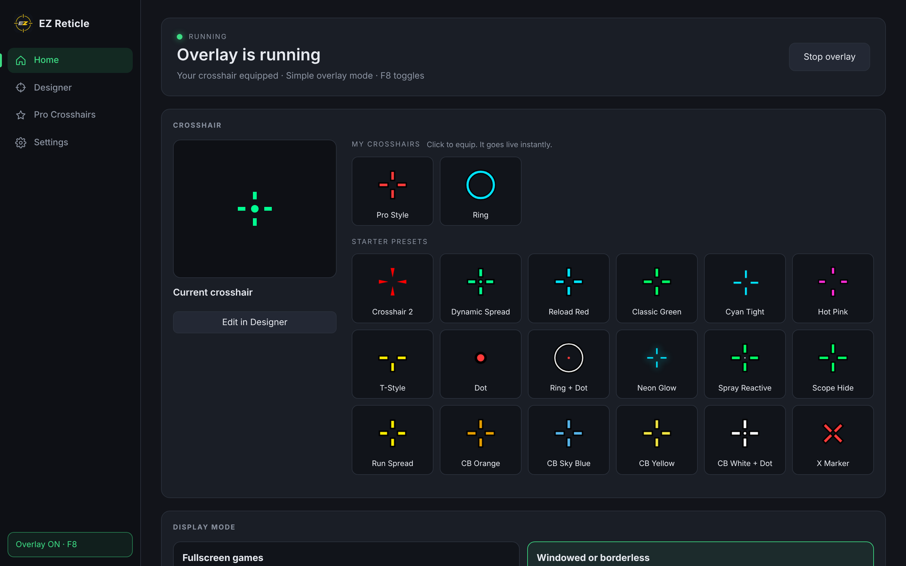
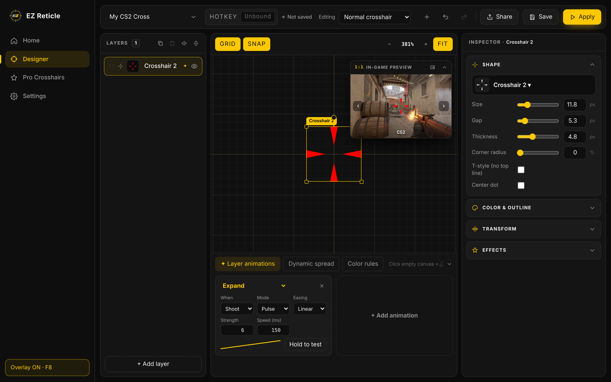

<p align="center">
  
</p>

<h1 align="center">EZ Reticle</h1>

<p align="center">
  A free crosshair overlay for Windows. Design your own, load pro crosshairs, and have it react to what you do in game.
</p>

<p align="center">
  
</p>

## Features

- **Overlay:** a transparent, click-through, always-on-top crosshair that never takes focus from your game. Toggle it with a hotkey (F8 by default).
- **Layered designer:** build a crosshair from shapes, images (including GIFs), text and freehand drawing, with live preview, undo/redo, outline, glow, rounded edges and separate fill and outline opacity.
- **Pro crosshairs:** 99 pro player crosshairs, plus CS2 share code (`CS…`) import and export and console commands.
- **Dynamics:** the crosshair spreads while you move, run, shoot, jump or reload, with adjustable speed and easing curves.
- **Color rules:** blend toward a color while an action is active (e.g. red while reloading).
- **States:** a different crosshair while you hold Aim, Reload, Jump, Run, Move or Shoot.
- **Animations:** pulse, flash, spin, fade and more, driven by triggers you can rebind.
- **Per-game crosshairs:** switch automatically when a game's window is active.
- **Accurate centering:** handles Windows display scaling and multiple monitors, with an on-screen alignment guide and manual offsets.
- **Layer tools:** copy/paste style, mirror, flip, saved crosshairs, and shareable `XH1:` codes.
- **Light on resources:** Balanced, Low and Lowest memory modes.
- **Themeable:** pick your own accent color.

<p align="center">
  
</p>

## Download

Grab the latest `EZ-Reticle-Setup-x.y.z.exe` from the [Releases](../../releases) page and run it.

Windows may show an "unknown publisher" warning because the app isn't code-signed yet. Choose **More info → Run anyway**.

## Run from source

Requires [Node.js](https://nodejs.org) (LTS).

```
npm install
npm start
```

## Build the installer

```
npm run dist
```

The installer is written to `dist/EZ-Reticle-Setup-<version>.exe`.

## Use in games

- Run your game in **borderless windowed** for the most reliable overlay. Exclusive fullscreen can hide overlays.
- Use **Settings → Alignment** to confirm the crosshair is exactly centered.
- The app reads global key and mouse input so dynamics, states and triggers can react. Some anti-cheat systems treat overlays and input hooks strictly, so check the rules of the game or league you play in before relying on it.

## More

- [Full guide](docs/GUIDE.md): settings, memory modes, share codes and building in detail.
- [Changelog](CHANGELOG.md)

## Contributing

Issues and pull requests are welcome.


